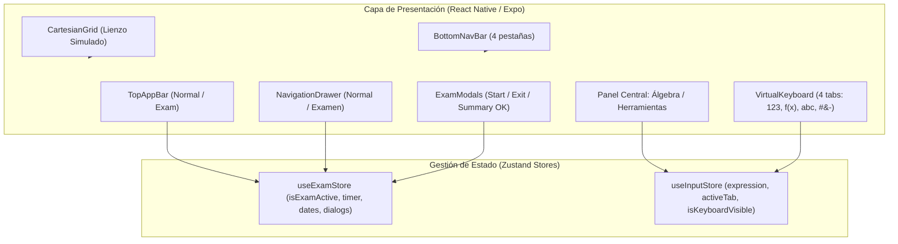
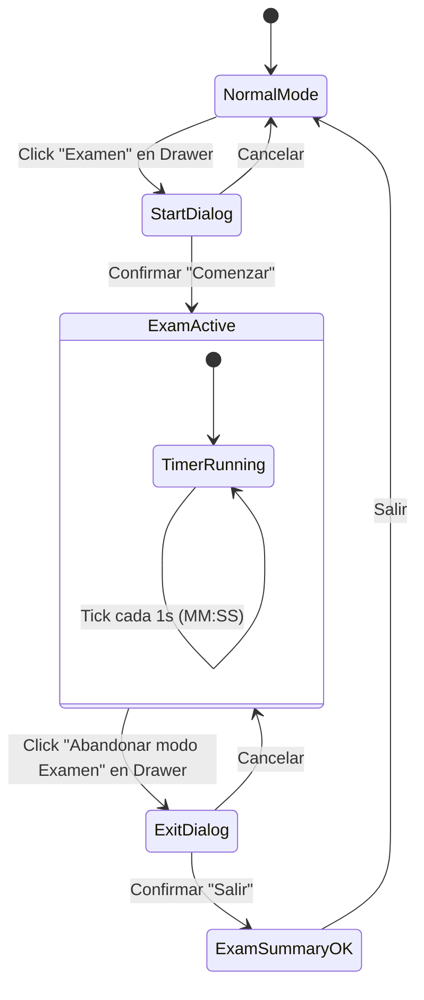

<div align="center">

# GeoGebra Android UI Replica (Expo / React Native)

[](https://www.typescriptlang.org/)
[](https://expo.dev/)
[](https://play.google.com/store/apps/details?id=org.geogebra.android)
[](https://conventionalcommits.org)
[](https://jestjs.io/)
[](https://github.com/pmndrs/zustand)

**Réplica 1:1 de alta fidelidad de la interfaz de usuario de GeoGebra Calculadora Gráfica para Android (Play Store), desarrollada con enfoque TDD estricto, sin motor de cálculo matemático.**

</div>

---

## 1. Executive Summary & Capabilities

El proyecto implementa la interfaz visual completa de la aplicación **GeoGebra Calculadora Gráfica** para Android tomando como oráculo de diseño 13 capturas de pantalla de la aplicación real (`assets/`).

### Capacidades Principales
- **Lienzo Cartesiano (`CartesianGrid`):** Renderizado de cuadrícula milimétrica (#E2E2E6), ejes ortogonales con flecha indicadora en X y etiquetas numéricas idénticas a la aplicación móvil.
- **TopAppBar Dinámica:**
  - *Modo Normal:* Fondo blanco, botón de menú hamburguesa y engranaje de ajustes.
  - *Modo Examen:* Fondo verde esmeralda (#008476 y #02332D), título `Calc. Gráfica`, cronómetro en vivo (`MM:SS`), indicador de batería e icono.
- **Navegación Inferior (4 pestañas):** Pestañas de **Álgebra**, **Herramientas**, **Tabla** y **Hoja de Cálculo**, con píldora de selección violeta (#E8E5FF / #695BD4) que alterna automáticamente al verde esmeralda institucional (#004D40 / #00695C) al iniciar el examen.
- **Teclado Virtual Matemático:** 4 pestañas interactivas (`123`, `f(x)`, `abc`, `#&¬`), variables matemáticas, operadores, teclado numérico y cursor.
- **Galería de Herramientas:** Categorías *Herramientas básicas* y *Edición* con layout de rejilla responsiva idéntica a Android.
- **Ciclo Completo de Modo Examen:**
  - Apertura desde NavigationDrawer.
  - Diálogo de confirmación *"Iniciar Examen"* con toast *"Esta aplicación está fijada"*.
  - Menú lateral restringido (*Registro de Examen*, *Abandonar modo Examen*).
  - Diálogo de confirmación de salida *"¿Estás seguro que quieres salir del modo Examen?"*.
  - Diálogo resumen final *"Examen: OK"* con encabezado verde, cálculo de duración real, fecha y horas de inicio y fin.

---

## 2. Visual Architecture

### Flujo de Datos y Componentes


### Máquina de Estados del Modo Examen


---

## 3. Estrategia TDD & Matriz de Cobertura

El desarrollo se ejecutó bajo la disciplina **Red-Green-Refactor**. Cada componente y store cuenta con su suite de pruebas automatizadas:

| Componente / Módulo | Archivo de Prueba | Cobertura / Verificación |
|---|---|---|
| **Design Tokens** | `src/theme/__tests__/tokens.test.ts` | Colores exactos extraídos de `assets/` (violeta, verde esmeralda, bordes) |
| **Exam State Store** | `src/stores/__tests__/useExamStore.test.ts` | Transiciones de estado, cálculo de cronómetro y timestamps |
| **Input Store** | `src/stores/__tests__/useInputStore.test.ts` | Inserción de caracteres, borrado (backspace) y alternancia de pestañas |
| **Cartesian Grid** | `src/components/canvas/__tests__/CartesianGrid.test.tsx` | Ejes ortogonales X/Y, cuadrícula milimétrica y flecha indicadora |
| **Top App Bar** | `src/components/navigation/__tests__/TopAppBar.test.tsx` | Variante normal vs variante institucional verde con timer |
| **Bottom Nav Bar** | `src/components/navigation/__tests__/BottomNavBar.test.tsx` | Las 4 pestañas y su cambio cromático en modo examen |
| **Virtual Keyboard** | `src/components/keyboard/__tests__/VirtualKeyboard.test.tsx` | Renderizado de las 4 pestañas, grid de teclas numéricas y operadores |
| **Tools Gallery** | `src/components/tools/__tests__/ToolsGallery.test.tsx` | Categorías *Básicas* y *Edición*, selección de herramientas |
| **Navigation Drawer** | `src/components/navigation/__tests__/NavigationDrawer*.test.tsx` | Opciones completas en modo normal vs opciones restringidas en examen |
| **Exam Modals** | `src/components/exam/__tests__/*.test.tsx` | Diálogos de inicio, confirmación de salida y resumen *"Examen: OK"* |
| **End-to-End Integration** | `__tests__/App.test.tsx` | Flujo completo e interactivo de la app de punta a punta |

---

## 4. Guía de Ejecución y Compilación Reproducible

### Requisitos Previos
- Node.js >= 20.x
- npm >= 10.x
- Dispositivo Android con Expo Go o Emulador Android SDK

### Instalación de Dependencias
```bash
# Clonar repositorio
git clone <url-del-repo>
cd geogarca

# Instalar paquetes
npm install --legacy-peer-deps --ignore-scripts
```

### Ejecutar Pruebas Automatizadas (TDD)
```bash
# Correr suite completa de 15 suites y 37 tests
npm test

# Verificación de tipos TypeScript estricto
npm run typecheck
```

### Iniciar la Aplicación en Desarrollo
```bash
# Iniciar servidor Expo
npx expo start

# Iniciar directamente en emulador Android
npx expo start --android
```
