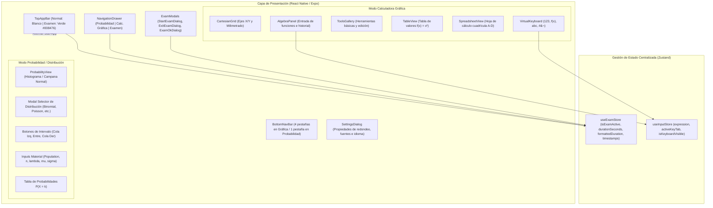
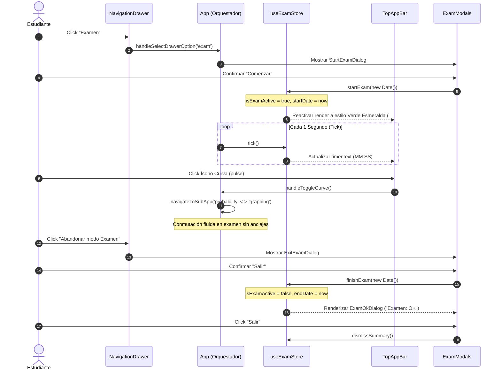

<div align="center">

# GeoGebra Suite Calculadora (Android Replica)

[](https://www.typescriptlang.org/)
[](https://expo.dev/)
[](https://play.google.com/store/apps/details?id=org.geogebra.android)
[](LICENSE)
[](https://conventionalcommits.org)
[](https://jestjs.io/)
[](https://reactnative.dev/)

**Réplica de alta fidelidad 1:1 para Android de GeoGebra Suite Calculadora (Calculadora Gráfica & Probabilidad / Distribución) desarrollada bajo arquitectura TDD estricta y empaquetada con Expo SDK 58 y EAS.**

</div>

---

## 1. Executive Summary & Capabilities

El proyecto implementa la experiencia móvil completa de **GeoGebra Suite Calculadora** para Android, reproduciendo con exactitud milimétrica la apariencia, paleta de colores y flujos de navegación observados en la aplicación oficial de Google Play Store y en exámenes supervisados.

### Capacidades Técnicas Principales
- **Arquitectura Multi-Calculadora (Suite):**
  - **Calculadora Gráfica:** Lienzo cartesiano ortogonal interactivo, panel de álgebra con expresiones simuladas (`f(x) = x²`, `A = (2, 3)`), teclado virtual matemático completo de 4 filas y navegación inferior de 4 pestañas (**Álgebra**, **Herramientas**, **Tabla**, **Hoja de Cálculo**).
  - **Probabilidad (Distribución):** Módulo de distribuciones estadísticas con histogramas discretos de barras violetas, curvas continuas gaussianas sombreadas, selector desplegable de distribuciones, botones de intervalos (`] ≤ ]`, `[ ≤ X ≤ ]`, `[ ≥ [`) y tabla de probabilidades $P(X = k)$.
- **Mocks Hardcodeados de Distribución:**
  - *Hipergeométrica:* $N=30$, $n=10$, $s=8$, barras escalonadas con barra activa rellena `#534686`.
  - *Binomial:* $n=20$, $p=0.5$, distribución simétrica con cálculo de intervalos y tabla de valores.
  - *Poisson:* $\lambda = 4$, distribución asimétrica positiva con cola derecha.
  - *Normal:* $\mu = 0$, $\sigma = 1$, curva continua en campana con sombreado dinámico de área.
  - *Geométrica:* $p = 0.3$, probabilidades estrictamente decrecientes.
- **TopAppBar Institucional con Modo Examen:**
  - *Normal:* Fondo blanco `#FFFFFF`, botón de menú lateral, atajo a Probabilidad (`📈`), tabla (`⊞`) y engranaje de propiedades (`⚙`).
  - *Examen:* Encabezado verde esmeralda institucional (`#008476` y `#02332D`), título `Suite Calculadora`, cronómetro dinámico en vivo (`MM:SS`), porcentaje de batería con icono y botones de acción rápida.
- **Navegación Anti-Bloqueo (Anti-Anclaje):**
  - Navegación bidireccional fluida que permite alternar entre `Calculadora Gráfica` y `Probabilidad` tanto en modo normal como durante el examen activo a través del menú lateral o del botón de curva superior.
- **Ciclo Completo de Examen Oficial:**
  - Inicio de examen desde menú lateral con diálogo informativo y toast *"Esta aplicación está fijada"*.
  - Menú lateral restringido con acceso a *Registro de Examen* y *Abandonar modo Examen*.
  - Diálogo de confirmación de salida y modal resumen *"Suite Calculadora GeoGebra: Examen: OK"* con cálculo de duración exacta, fecha formateada en español, horas de inicio y fin, y botón violeta *"Salir"*.

---

## 2. Visual Architecture

### Flujo de Datos y Jerarquía de Componentes


### Ciclo de Vida y Transiciones del Modo Examen


---

## 3. Protocol & API Specifications

### Esquema de Estado del Examen (`ExamState`)
```json
{
  "$schema": "http://json-schema.org/draft-07/schema#",
  "title": "ExamState",
  "type": "object",
  "properties": {
    "isExamActive": { "type": "boolean" },
    "isStartModalOpen": { "type": "boolean" },
    "isConfirmExitOpen": { "type": "boolean" },
    "isSummaryOpen": { "type": "boolean" },
    "elapsedSeconds": { "type": "integer", "minimum": 0 },
    "formattedDuration": { "type": "string", "pattern": "^[0-9]{2}:[0-9]{2}$" },
    "startDate": { "type": ["string", "null"], "format": "date-time" },
    "endDate": { "type": ["string", "null"], "format": "date-time" },
    "batteryLevel": { "type": "integer", "minimum": 0, "maximum": 100 }
  },
  "required": ["isExamActive", "elapsedSeconds", "formattedDuration", "batteryLevel"]
}
```

### Payload del Resumen de Examen (`ExamOkDialog`)
```json
{
  "title": "Suite Calculadora GeoGebra",
  "status": "Examen: OK",
  "instructions": "Muestra esta pantalla a tu profesor",
  "metrics": {
    "duration": "41:04",
    "date": "26 Octubre 2026",
    "startTime": "20:08:26",
    "endTime": "20:49:30"
  }
}
```

---

## 4. Estrategia TDD & Matriz de Cobertura

El desarrollo se ejecutó rigurosamente bajo la disciplina **Test-Driven Development (TDD)**, alcanzando una cobertura de 20 suites y 54 pruebas unitarias e integrales 100% en verde:

| Módulo / Componente | Archivo de Prueba | Cobertura Funcional Verificada |
|---|---|---|
| **Design Tokens** | `src/theme/__tests__/tokens.test.ts` | Tokens de color oficiales (#695BD4, #008476, #02332D, etc.) |
| **Exam Store** | `src/stores/__tests__/useExamStore.test.ts` | Transiciones de examen, cronómetro en vivo, cálculo de duraciones |
| **Input Store** | `src/stores/__tests__/useInputStore.test.ts` | Manejo de expresiones matemáticas y estado de teclado virtual |
| **Cartesian Grid** | `src/components/canvas/__tests__/CartesianGrid.test.tsx` | Renderizado ortogonal, grilla milimétrica y flecha indicadora X |
| **Top App Bar** | `src/components/navigation/__tests__/TopAppBar.test.tsx` | Cabecera normal vs examen institucional verde, timer y 3 botones de acción |
| **Bottom Nav Bar** | `src/components/navigation/__tests__/BottomNavBar.test.tsx` | Pestaña única `Distribución` (Probabilidad) vs 4 pestañas (Gráfica) |
| **Navigation Drawer** | `src/components/navigation/__tests__/NavigationDrawer*.test.tsx` | Opciones completas y alternancia de sub-apps en modo normal y examen |
| **Modales de Examen** | `src/components/exam/__tests__/*.test.tsx` | Iniciar Examen, Salir de Examen y Resumen `Examen: OK` con timestamps |
| **Vista Probabilidad** | `src/components/probability/__tests__/ProbabilityView.test.tsx` | Mocks de Hipergeométrica, Binomial, Poisson, Normal, intervalos y tabla |
| **Tabla de Valores** | `src/components/table/__tests__/TableView.test.tsx` | Generación de tabla $x \in [-2, 2]$ para $f(x) = x^2$ |
| **Hoja de Cálculo** | `src/components/spreadsheet/__tests__/SpreadsheetView.test.tsx` | Cuadrícula de columnas A, B, C, D e índices de fila 1, 2, 3, 4, 5 |
| **Propiedades / Settings**| `src/components/settings/__tests__/SettingsDialog.test.tsx` | Modal de ajustes de redondeo, tamaño de fuente e idioma |
| **Teclado Virtual** | `src/components/keyboard/__tests__/VirtualKeyboard.test.tsx` | Categorías 123, f(x), abc, #&¬ y pulsación de teclas |
| **Galería de Herramientas**| `src/components/tools/__tests__/ToolsGallery.test.tsx` | Pestañas de herramientas básicas y edición |
| **Panel Álgebra** | `src/components/algebra/__tests__/AlgebraPanel.test.tsx` | Tarjetas de funciones, puntos y barra interactiva de entrada |
| **Integración E2E** | `__tests__/App.test.tsx` | Flujo integral: navegación completa, examen, conmutación y cierre |

---

## 5. Guía de Ejecución y Compilación Reproducible

### Requisitos Previos
- Node.js >= 20.x
- npm >= 10.x
- Expo CLI (`npx expo`)
- EAS CLI (`npx eas-cli@latest`)

### Instalación Paso a Paso
```bash
# 1. Clonar el repositorio
git clone --recursive git@github.com:nedder3/geogarca.git
cd geogarca

# 2. Instalar dependencias exactas del SDK 58
npm install --legacy-peer-deps --ignore-scripts

# 3. Ejecutar suite de pruebas automatizadas (TDD)
npm test

# 4. Verificar compilación estricta de TypeScript
npm run typecheck

# 5. Comprobar salud del entorno con Expo Doctor
npx expo-doctor
```

### Ejecutar Localmente en Desarrollo
```bash
# Iniciar Metro Bundler
npx expo start

# Ejecutar directamente en emulador o dispositivo Android
npx expo start --android
```

### Generación de APK Standalone de Producción / Preview
```bash
# Compilar APK Android en la nube de EAS
npx eas build -p android --profile preview
```
